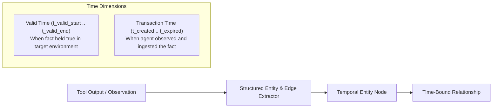
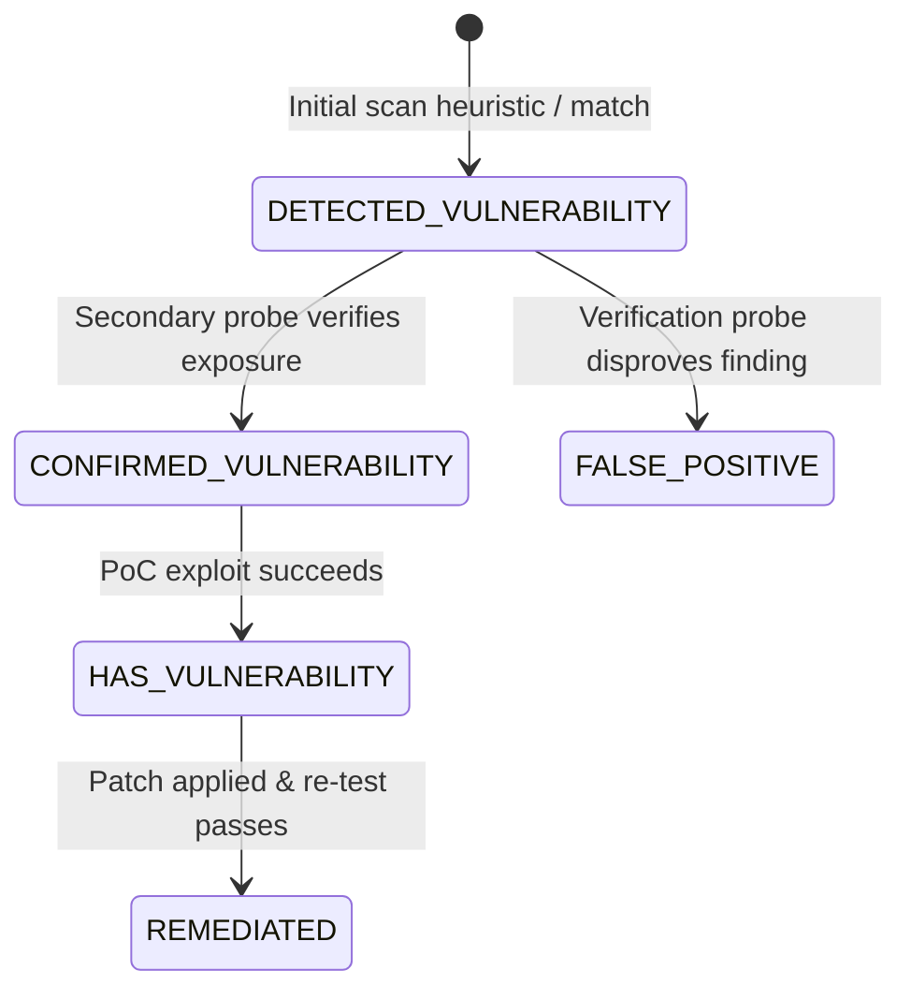

# Agentic Temporal Knowledge Graphs (Bi-Temporal Memory & Graphiti)

This skill specifies engineering patterns for time-evolving **Knowledge Graphs** and **Episodic Agent Memory**, ensuring autonomous agents maintain accurate temporal state without corrupting historical context.

---

## ⏳ 1. Bi-Temporal Modeling in Agent Memory

Traditional vector databases treat memory as flat document embeddings. Temporal knowledge graphs introduce **bi-temporal timestamps** to model both physical and cognitive reality:



### Time Dimensions
1. **Valid Time (`t_valid`)**: The window during which the state existed in the target system (e.g., port open from 14:00 to 14:30).
2. **Transaction Time (`t_transaction`)**: The timestamp when the agent's observation was recorded into the graph database.

When an observation invalidates a previous fact (e.g., a closed port or patched service), the old edge is retired by setting `t_valid_end` rather than deleting the relationship, preserving full auditability.

---

## 🧠 2. Three-Tier Memory Partitioning

To avoid pollution between tactical execution and durable knowledge:

```
+------------------------------------------------------------------------+
| 1. Episodic Memory (Per-Session / Execution Trajectory)                |
| - Raw tool calls, return codes, command outputs, timestamps, errors    |
| - Modeled as a sequential event DAG linked to active subtask ID        |
+------------------------------------------------------------------------+
                                    | (Extraction & Consolidation)
                                    v
+------------------------------------------------------------------------+
| 2. Semantic Temporal Graph (Target State & Entity Topologies)          |
| - Hosts, services, users, software versions, configurations           |
| - Bi-temporal relationships with state machines                        |
+------------------------------------------------------------------------+
                                    | (Sanitization & Anonymization)
                                    v
+------------------------------------------------------------------------+
| 3. Procedural Memory (Reusable Tactical Playbooks)                     |
| - De-anonymized techniques, command templates, remediation steps       |
| - Stored with generic placeholders ({target_ip}, {domain})             |
+------------------------------------------------------------------------+
```

---

## 🛡️ 3. Engagement State Machine in Graphs

For security assessments and system diagnostics, model finding lifecycles as directed state machine edges:



- Each state transition creates a new timestamped edge linked to the tool execution that provided verifiable evidence.
- Nodes track confidence score, severity, CVE identifiers, and affected asset URNs.

---

## 🔍 4. Hybrid Graph + Vector Retrieval (RRF)

Combine graph traversals with dense vector search to answer agent queries:

```text
Score(Node) = α * RRF_Graph(Node) + (1 - α) * RRF_Vector(Node)
```

1. **Graph Traversal**: Cypher or Graphiti queries retrieve adjacent entities (e.g., all services exposed on host $H$ running software $S$).
2. **Dense Vector Search**: Semantic similarity against chunked observations.
3. **Reciprocal Rank Fusion (RRF)**: Merges ranked lists using $k \approx 60$, delivering context that is both topologically precise and semantically relevant.
