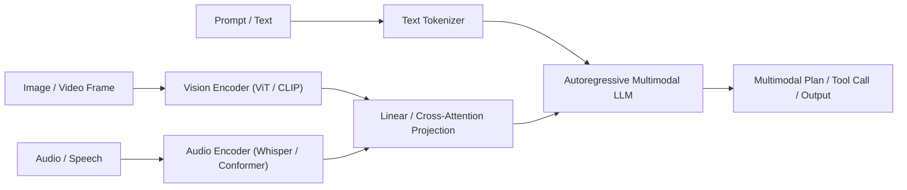
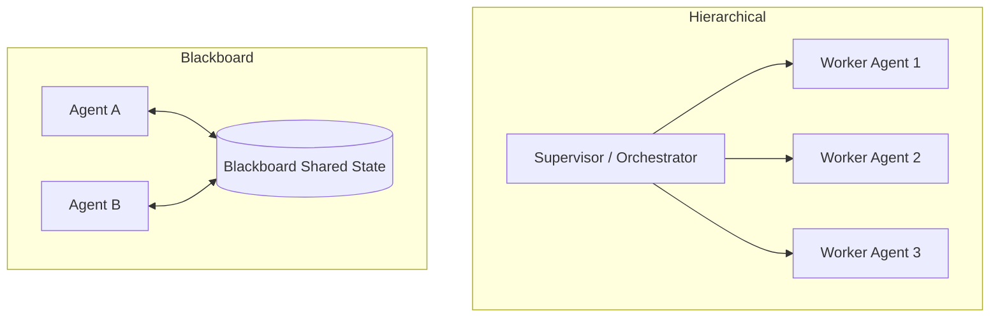

# Multimodal Generative AI and Agentic Architecture

This skill specifies engineering patterns for **Multimodal AI** and **Agentic Architectures**, integrating text, vision, audio, and structured data into autonomous, collaborative systems.

---

## 👁️ 1. Multimodal Processing Architecture

Multimodal systems synthesize representations across distinct sensory modalities into shared latent embeddings or interleaved token streams:



### 1.1 Cross-Modality Projection
- **Linear Projection Layers**: Projects visual tokens $\mathbf{z}_v \in \mathbb{R}^{N \times D_v}$ to language space $\mathbb{R}^{N \times D_{llm}}$.
- **Perceiver / Cross-Attention Resamplers**: Compresses high-resolution images or multi-frame video tokens into fixed-length queries (e.g., 64 tokens) before feeding the backbone, preventing context exhaustion.

---

## 🤖 2. Agent Collaboration Topologies



### 2.1 Multi-Agent Topologies
1. **Hierarchical Orchestration**: A central reasoning agent decomposes goals, assigns subtasks to specialized domain agents, monitors execution budgets, and aggregates results.
2. **Peer-to-Peer Consensus**: Autonomous agents communicate directly via structured protocols (JSON/TOON messages) to negotiate decisions or debate hypotheses.
3. **Blackboard Architecture**: Agents observe a shared workspace state, triggering actions opportunistically when their activation precondition is met.

---

## 🧠 3. Agent Cognitive Loops and Memory Architecture

### 3.1 Cognitive Loop: OODA & ReAct
- **Observe**: Capture sensory inputs (logs, code, user messages, UI states).
- **Orient**: Re-evaluate goal status, assess constraint boundaries, recall relevant memories.
- **Decide**: Formulate next best action, tool invocation, or communication step.
- **Act**: Execute tool, apply state transition, record action in working memory.

### 3.2 Memory Hierarchy
```
+-------------------------------------------------------+
| Ephemeral Working Memory (Current Prompt / Context)   |
+-------------------------------------------------------+
| Episodic Memory (Session Chat History / Trajectory)   |
+-------------------------------------------------------+
| Semantic Memory (Vector Store / Knowledge Base / RAG) |
+-------------------------------------------------------+
| Procedural Memory (Registered Tools / Skills / Rules) |
+-------------------------------------------------------+
```

---

## 🛡️ 4. Guardrails and Safety Boundaries

1. **Role Drift Prevention**: Agents must strictly adhere to their declared purpose (`agent.source.md`) and refuse tasks violating safety boundaries.
2. **Tool Execution Sandboxing**: Execute shell and code tools in constrained, isolated environments with timeout limits and rate caps.
3. **Loop Detection and Halting**: Terminate when reasoning loops repeat identical observations or exceed maximum step budgets.
