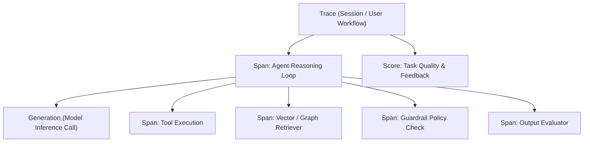

# LLM & Multi-Agent Observability (OpenTelemetry & Langfuse)

This skill specifies runtime telemetry, distributed tracing, and evaluation patterns for LLMs, agent cognitive loops, and tool execution flows using **OpenTelemetry GenAI Semantic Conventions (`gen_ai.*`)** and **Langfuse**.

---

## 🎯 1. Observation Hierarchy and Spans

Instrument agent workflows using a strictly typed observation hierarchy:

### Observation Types
1. **Trace**: Represents the end-to-end task lifecycle, carrying `trace_id`, user metadata, and session boundaries.
2. **Span**: Captures timed functional units with distinct categories:
   - `Agent`: Overall deliberation or cognitive step.
   - `Tool`: External utility, terminal command, or API execution.
   - `Chain`: Multi-step reasoning pipeline or sub-graph traversal.
   - `Retriever`: Dense/sparse retrieval and reranking queries.
   - `Guardrail`: Security check or policy enforcement gate.
   - `Evaluator`: AI-as-a-judge or metric verification assertion.
3. **Generation**: Captures model requests and responses, recording input messages, completion choices, sampling parameters, token metrics, and reasoning signatures.
4. **Score & Event**: Numerical or boolean evaluation metrics (e.g., accuracy, latency, cache efficiency) attached to traces or spans.

---

## 📊 2. OpenTelemetry GenAI Semantic Conventions

Standardize all model attributes according to the `gen_ai.*` OpenTelemetry schema:

| Attribute | Description | Example |
| :--- | :--- | :--- |
| `gen_ai.system` | Provider name | `anthropic`, `googleai`, `openai`, `ollama` |
| `gen_ai.request.model` | Target model identifier | `claude-3-7-sonnet`, `gemini-2.5-flash`, `gpt-4o` |
| `gen_ai.request.temperature` | Sampling temperature | `1.0` (budget thinking), `0.2` (deterministic) |
| `gen_ai.request.top_p` | Nucleus sampling parameter | `0.95` |
| `gen_ai.request.max_tokens` | Completion token cap | `4096` |
| `gen_ai.usage.input_tokens` | Effective prompt token count | `1500` |
| `gen_ai.usage.output_tokens` | Generated completion tokens | `350` |
| `gen_ai.usage.reasoning_tokens`| Extended thinking tokens consumed | `2048` |

---

## 💰 3. Prompt Caching Telemetry & Token Cost Attribution

To measure economic and latency gains from prompt caching, record cache breakdown metrics for each generation:

### Cache Metrics Matrix
- **Anthropic**:
  - `CacheCreationInputTokens`: Tokens written to prefix cache (charged at 125% base rate).
  - `CacheReadInputTokens`: Tokens read from prefix cache (charged at 10% base rate).
- **Google Gemini**:
  - `PromptCachedTokens`: Ephemeral or explicit cached tokens (~75% to 89%+ discount).
- **OpenAI**:
  - `PromptCachedTokens`: Automatically cached prompt tokens deducted from billed input.

### Cache Efficiency Metric
Calculate and log the cache hit ratio for each turn:
$$\text{CacheHitRatio} = \frac{\text{CachedTokens}}{\text{TotalPromptTokens}} \times 100\%$$

---

## ⚡ 4. Asynchronous Queue Management & Graceful Flush

To prevent observability overhead from blocking agent execution:
1. **Background Event Queue**: Observations and spans are buffered into an asynchronous worker queue.
2. **Batch Ingestion**: Events are grouped into batches and sent periodically to the observability collector.
3. **Deterministic Flush on Exit**:
   - `ForceFlush`: Triggered immediately before presenting deliverables to ensure complete traces.
   - `Shutdown`: Flushes all queued telemetry with a bounded timeout upon session termination.
4. **PII & Secret Redaction**: Sanitize credentials, API keys, private keys, and sensitive tokens in observation payloads before queuing.
