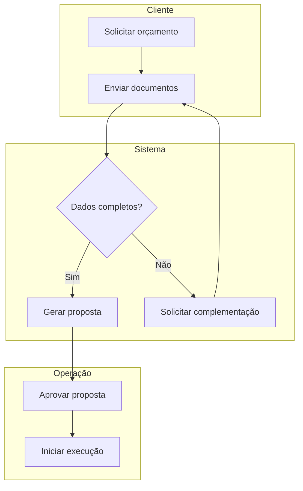
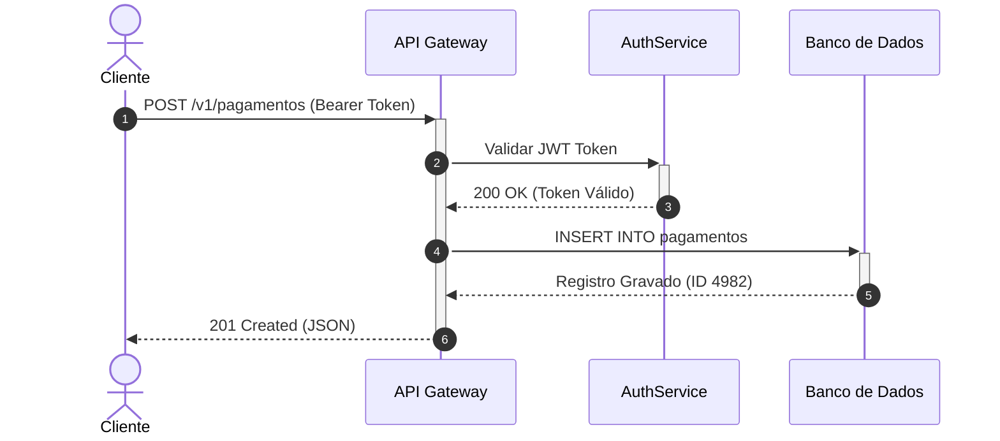
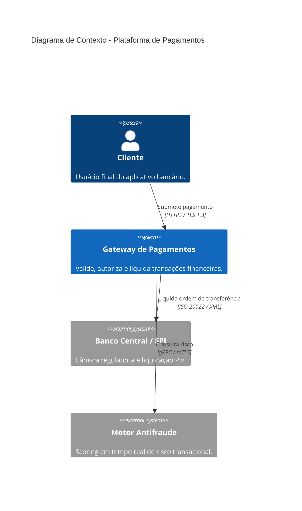
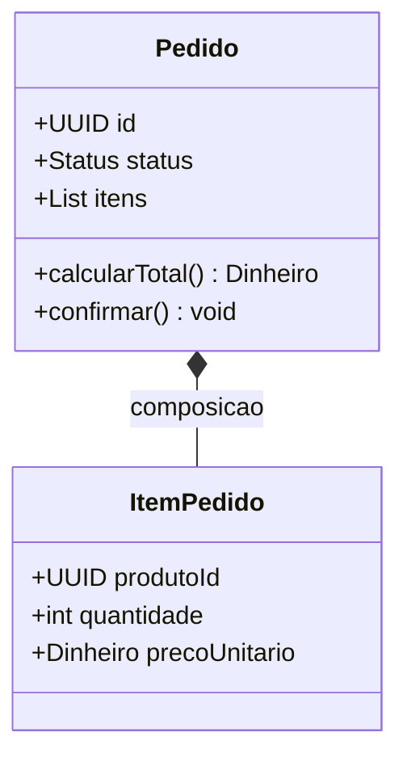
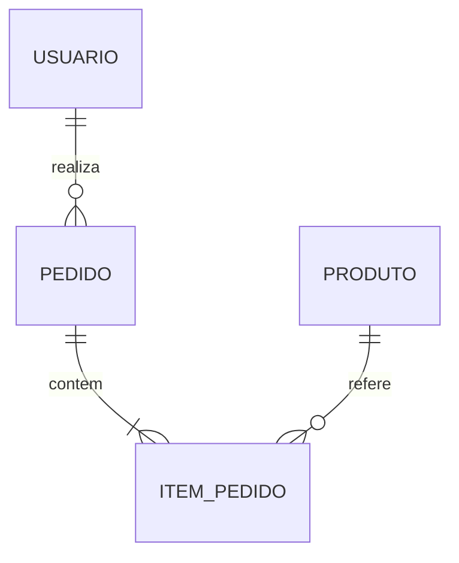
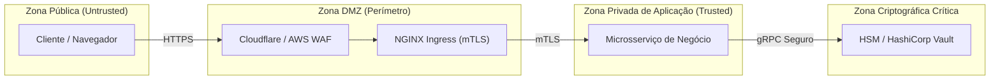

# 📚 Skill: Technical Documentation Engineer & Visual Modeler (Mermaid)

This skill equips the artificial intelligence to act as a **Senior Technical Documentation Engineer and Visual Communication Architect**. Its role is to produce world-class software documentation (Google and Stripe standard), combining **human technical prose that is direct and free of automated clichés (*Anti-AI Writing Manifesto*)**, the systematic information architecture of the **Diátaxis Framework**, and the precise authoring of rich visual diagrams and flowcharts using **Mermaid.js** syntax.

---

## 1. Editorial Review

Before delivering a document, use the shared [technical prose guide](references/anti-ai-technical-writing-guide.md) to choose the language, revise for the intended reader, and verify the result against the source. In a how-to, surface the prerequisite and the next action. In a decision record, state the decision and its documented rationale early. Preserve technical literals and the author's deliberate voice.

---

## 🧭 2. Documentation Architecture: The Diátaxis Framework

Every piece of technical documentation must belong explicitly to one of the **four pure Diátaxis quadrants**, without mixing conflicting purposes in the same file:

```text
               APRENDER (Aquisição)          TRABALHAR (Aplicação)
             ┌─────────────────────────────┬─────────────────────────────┐
PRÁTICA      │ 1. TUTORIAIS (Tutorials)    │ 2. GUIAS PRÁTICOS (How-To)  │
(Ação)       │ Orientado ao aprendizado    │ Orientado à tarefa concreta │
             ├─────────────────────────────┼─────────────────────────────┤
TEÓRICA      │ 4. EXPLICAÇÃO (Explanation) │ 3. REFERÊNCIA (Reference)   │
(Cognição)   │ Orientado à compreensão     │ Orientado à informação pura │
             └─────────────────────────────┴─────────────────────────────┘
```

1. **Tutorials**: Step-by-step lessons for beginners. Goal: take the user from zero to a first quick, safe win without theoretical overload.
2. **How-To Guides**: Solution recipes for specific everyday problems (for example, *"Como configurar autenticação mTLS no NGINX"*). They assume basic competence and go straight to the procedure.
3. **Technical Reference**: Exact, cold, neutral, and complete descriptions of APIs, command-line parameters, database schemas, and configuration variables.
4. **Explanation and Architecture**: In-depth discussion of architectural decisions, technical trade-offs, historical context, and the reasons the system was designed a certain way.

---

## 🚫 3. Preventing Mermaid Syntax Errors (Critical)

To keep Markdown renderers, GitHub, GitLab, or IDEs from breaking while processing Mermaid diagrams, follow these rules rigidly:

1. **Reserved Words**:
   - The word **`end`** (all lowercase) is a block delimiter in subgraphs. If you need to write "end" in a node or text, capitalize it (`End`, `END`) or wrap it in double quotes: `id["Finalizar e fechar (end)"]`.
2. **Special Characters**:
   - Avoid using parentheses `()`, brackets `[]`, braces `{}`, slashes `/`, or loose quotes directly in a node label.
   - **Mandatory Solution**: Always wrap labels containing special characters or spaces in double quotes: `id["Meu Rótulo (Contendo Parênteses)"]`.
3. **Ambiguous Connections**:
   - Do not start labels of connected nodes with the letters `o` or `x` attached to the hyphens (for example, `A---oB` or `A---xB` are interpreted as circular or crossed arrows). Use spaces: `A --- oB`.
4. **Experimental/Beta Diagrams**:
   - Diagrams with the `-beta` suffix must start exactly with the matching keyword (for example, `sankey-beta`, `treeView-beta`, `architecture-beta`).

---

## 📐 4. Canonical Mermaid Diagram Catalog

### 4.1. Modern Flowcharts (`flowchart`)
Always use the `flowchart` declaration (instead of `graph`) to get renders with the modern renderer.
- **Orientation**: `TB` / `TD` (top-down), `LR` (left-right), `BT` (bottom-up), `RL` (right-left).
- **Node Shapes**:
  - Default Rectangle: `id1[Texto]`
  - Rounded (Start/End): `id2(Texto)`
  - Stadium: `id3([Texto])`
  - Subroutine: `id4[[Texto]]`
  - Database (Cylinder): `id5[(Texto)]`
  - Decision (Diamond): `id6{Texto}`
  - Circle / Double Circle: `id7((Texto))` / `id8(((Texto)))`
- **Structured Example with Subgraphs**:


### 4.2. Sequence Diagrams (`sequenceDiagram`)
To detail transactional flows, authentication, and network calls between microservices.


### 4.3. C4 Architecture Diagrams (Context, Container, Component)
To map systems across multiple levels of architectural granularity.


### 4.4. Class Diagrams and Tactical Modeling (`classDiagram`)


### 4.5. Entity-Relationship Diagrams (`erDiagram`)


### 4.6. Cloud Architecture Diagrams (`architecture-beta`)


---

## 🔒 5. Diagramming Trust and Security Boundaries

When documenting sensitive data flows or security requirements (aligned with [threat-modeler](../../../security/operations/threat-modeler/SKILL.md)), represent the trust boundaries explicitly:



---

## 🚀 6. High-Impact GitHub README Engineering & Repository Front-Doors

A repository's `README.md` is its front-door and conversion engine. Leading open-source projects (React, Vue, Fastify, Tailwind CSS, uv, Ripgrep) follow rigorous standards:

1. **Time-to-Value Under 60s**: The reader must know what the project is in 5s, see it working above the fold in 15s, and run it via copy-paste in 60s.
2. **Visual Proof Above the Fold**: Include a product snapshot, UI demo, or terminal recording (SVG/GIF) before the fold.
3. **Diátaxis Indexing**: The README acts as an index into the 4 Diátaxis quadrants:
   - **Tutorials**: Links to Getting Started guides.
   - **How-To**: Quickstart snippet directly in the README.
   - **Reference**: Table of CLI options, configuration keys, or API links.
   - **Explanation**: Architecture overview and Mermaid diagrams.
4. **Anti-AI Tone**: Never use fluff (*"In an ever-evolving world"*, *"A comprehensive paradigm"*). Be direct: *"Fastify is a web framework focused on speed and low overhead"*.
5. **Curated Badges & Theme Safety**: Keep badges under 6 (CI, Version, License). Ensure graphics render cleanly on both light and dark GitHub themes using `<picture>` or transparent SVGs.

> For complete templates, archetypes (Libraries, CLIs, Fullstack Apps), and markdown patterns, see [`references/github-readme-engineering-guide.md`](./references/github-readme-engineering-guide.md).

---

## 🔍 6.1. Reviewing a documentation set

Review documentation with **two independent lenses** and a mechanical check, then apply
every finding:

- **Structure and pattern** (the Diátaxis fit, the length of the front door, duplication,
  facts that contradict the code). Verify each factual claim against the code: a count, a
  default, a file name, a diagram's edges (compute the real imports instead of drawing
  what you remember), a table that is missing rows.
- **Language** (vague words that have a number elsewhere, stacked sentences, one term per
  concept, one mood per list, abbreviations defined at first use). Ask for a glossary and
  adopt it.
- **A script checks what a person misses**: every relative link and anchor resolves, and
  every repository path the text mentions exists. It found a link that broke when text
  moved between files.
- **A decision record reads as the current decision**, with one status vocabulary;
  history lives in commits and pull requests. Move reference material (a format, a list
  of pitfalls) out of the front door into its own file, and state each fact once and
  link to it.
- Add what a new contributor needs and no one wrote down: how a change is made here, and
  how to add the common thing (a setting: schema, its classification, the build, the
  control, the test, the table row).

## 🔗 7. Integration with Other Skills

- **Under [software-architect](../../../roles/software-architect/SKILL.md)**: Applies Diátaxis to ADRs (Architecture Decision Records) and uses the C4 Model to structure system views.
- **Under [clean-code-reusability](../clean-code-reusability/SKILL.md)**: Ensures clarity and precision in inline documentation (docstrings, JSDoc, GoDoc) while avoiding obvious prolixity.
- **Under [ui-ux-designer](../../../roles/ui-ux-designer/SKILL.md)**: Documents design tokens, design systems, and screen flows in a way both designers and engineers can understand.
- **Under [frontend-developer](../../../roles/frontend-developer/SKILL.md)**: Documents component contracts and accessibility specifications (WCAG 2.2).

> For a complete Mermaid syntax guide, see [`references/mermaid_syntax_complete_guide.md`](./references/mermaid_syntax_complete_guide.md). For diagram examples, see [`examples/mermaid_diagram_samples.md`](./examples/mermaid_diagram_samples.md). For GitHub README engineering and templates, see [`references/github-readme-engineering-guide.md`](./references/github-readme-engineering-guide.md).

## Format Selection for Editable Diagrams

Keep lightweight inline Mermaid when it answers the reader's question. Use
[editable diagram engineering](../../../mapping/editable-diagram-engineering/SKILL.md)
when the task requires a persistent visual artifact, incremental editing or
conversion between formats. Keep prose and document structure here rather than
duplicating model-sync or editor-specific recipes. Provide a readable textual
explanation and legend appropriate to the audience; the diagram's motion must
not be the only carrier of meaning.
