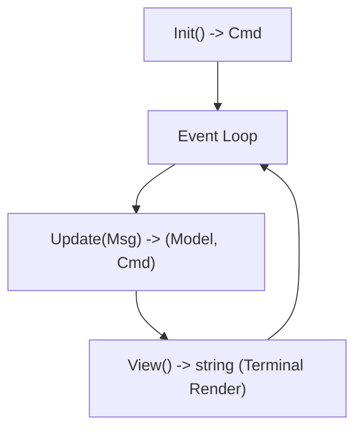

# Terminal UI (TUI) & Interactive CLI Engineering

This skill specifies software engineering patterns for building robust **Terminal User Interfaces (TUIs)** and interactive command-line applications using the **Model-View-Update (MVU / Elm)** architecture.

---

## 🫧 1. Model-View-Update (MVU) Architecture

Separate state, events, and rendering into distinct, pure phases:



### Core Components
1. **Model**: Pure data structure holding application state, dimensions, navigation stack, and component sub-models.
2. **Messages (`Msg`)**: Strongly typed events (keyboard inputs, window resize, asynchronous command completions, timer ticks).
3. **Update**: Pure function mapping an incoming message to a new state and zero or more asynchronous commands (`Cmd`).
4. **View**: Pure function transforming state into ANSI-rendered terminal string.

---

## 🎨 2. Declarative Terminal Layout & Height Discipline

Terminal grids operate under strict row/column constraints:

### Critical Height Rules (Lip Gloss / TUI Styles)
- **Minimum vs. Maximum Height**: Setting a bare `Height(1)` often acts as a minimum and expands when content wraps. For strict 1-line headers/footers, enforce `MaxHeight(1)` and `Inline(true)`.
- **Background Footers**: Avoid top/bottom borders on footers, which create inconsistent 2-row artifacts across terminal fonts. Use solid background colors with horizontal padding `Padding(0, 1)`.
- **Responsive Breakpoint Layouts**:
  ```text
  If Width < 80 cols:
      Compose vertically (JoinVertical)
  Else:
      Compose horizontally (JoinHorizontal) with split column ratio
  ```

---

## 📺 3. Interactive Components & Multi-Step Forms

Standardize component lifecycles for terminal interactivity:

1. **Viewports & Scrolling**:
   - Track progress percentage and boundaries (`AtTop()`, `AtBottom()`).
   - Use discrete scroll steps for lines and 2-step offsets for wide table/form panning.
2. **Multi-Step Wizards & Forms (Huh / Inquirer)**:
   - Group inputs into progressive stages.
   - Enforce client-side validation rules on text fields before transition.
   - Mask sensitive inputs (API tokens, passwords) in terminal echo mode.
3. **Asynchronous Agent Output Streaming**:
   - Ingest streaming chunks via dedicated background messages.
   - Auto-scroll the viewport only when the operator is anchored at the bottom, allowing unpinned reading while streaming continues.

---

## ⚙️ 4. Terminal Capabilities & Graceful Degradation

Ensure reliable execution across diverse user terminals and CI environments:

- **Color Support Detection**: Inspect `COLORTERM` (truecolor 24-bit), `TERM` (256-color), and `NO_COLOR` (strip all ANSI escapes).
- **PTY & Non-Interactive Fallback**: Check `isatty(stdout)`. In headless CI or piped contexts (`| grep`), degrade from interactive full-screen curses to plain, timestamped stream logs.
- **Signal Handling & Screen Restoration**: Catch `SIGINT`, `SIGTERM`, and `SIGWINCH`. Always restore the alternate terminal buffer (`\033[?1049l`) and cursor visibility (`\033[?25h`) on exit to prevent terminal corruption.
