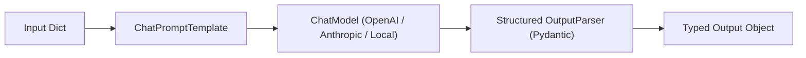
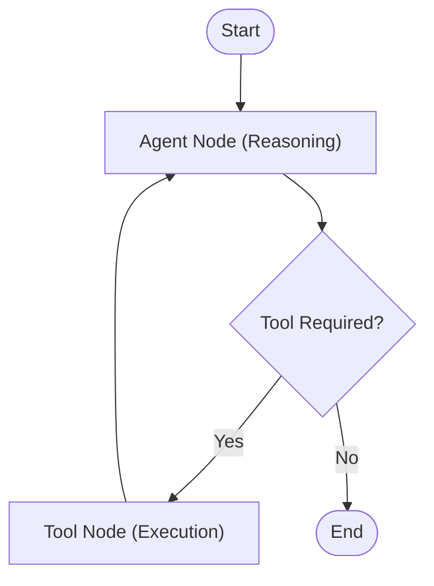

# Generative AI Engineering with LangChain and LangGraph

This skill provides design patterns and architectural standards for developing robust AI applications using **LangChain** and **LangGraph**.

---

## 🧩 1. LangChain Expression Language (LCEL) Architecture

LCEL enables declarative, streamable, and async-first pipeline composition:



### 1.1 Composition Principles
- **Uniform Interface**: All components implement `Runnable` (`invoke`, `ainvoke`, `stream`, `astream`, `batch`).
- **Parallel Execution**: `RunnableParallel` branches execution for parallel retrievals or multi-perspective prompts without thread overhead.
- **Dynamic Routing**: `RunnableBranch` or lambda routing functions dynamically dispatch based on input classification.

```python
from langchain_core.prompts import ChatPromptTemplate
from langchain_core.output_parsers import PydanticOutputParser
from langchain_core.runnables import RunnablePassthrough
from pydantic import BaseModel, Field

class DiagnosticSummary(BaseModel):
    key_findings: list[str] = Field(description="Summary of primary clinical findings")
    risk_score: float = Field(description="Normalized risk metric between 0.0 and 1.0")

parser = PydanticOutputParser(pydantic_object=DiagnosticSummary)

prompt = ChatPromptTemplate.from_messages([
    ("system", "Analyze clinical notes and provide structured diagnostic metrics.\n{format_instructions}"),
    ("user", "{clinical_text}")
]).partial(format_instructions=parser.get_format_instructions())

pipeline = prompt | model | parser
```

---

## 🔄 2. Stateful Workflows with LangGraph

LangGraph addresses the limitations of linear DAGs by introducing cyclical graphs, persistent state, human-in-the-loop validation, and multi-agent coordination.



### 2.1 State Graph Definition
```python
from typing import TypedDict, Annotated, Sequence
import operator
from langchain_core.messages import BaseMessage
from langgraph.graph import StateGraph, END

class AgentState(TypedDict):
    messages: Annotated[Sequence[BaseMessage], operator.add]
    intermediate_steps: list[str]
    iteration_count: int

def call_model(state: AgentState):
    response = model.invoke(state["messages"])
    return {"messages": [response], "iteration_count": state.get("iteration_count", 0) + 1}

workflow = StateGraph(AgentState)
workflow.add_node("agent", call_model)
workflow.add_node("action", execute_tools)

workflow.set_entry_point("agent")
workflow.add_conditional_edges("agent", router_condition, {"continue": "action", "finish": END})
workflow.add_edge("action", "agent")

app = workflow.compile()
```

---

## 🧬 3. Domain Adaptation: Life Sciences and Regulated Domains

From *LangChain for Life Sciences and Healthcare*:
1. **Strict Context Gating**: Inject negative constraint prompts (`"If information is not present in retrieved clinical records, respond: INSUFFICIENT_EVIDENCE"`).
2. **Deterministic Citations**: Bind metadata provenance (source document UID, page number, paragraph index) into structured outputs.
3. **Guardrails Integration**: Wrap chains with output validation to intercept PII, PHI (HIPAA), or hallucinated medical claims before presentation.
