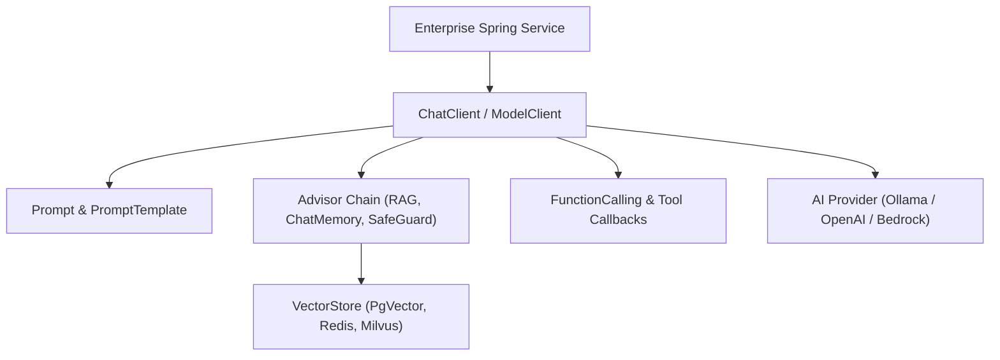

# Enterprise Generative AI with Spring AI

This skill provides comprehensive patterns for building enterprise Java applications powered by Generative AI and Large Language Models using the **Spring AI** framework.

---

## 🏛️ 1. Architecture and Core Abstractions

Spring AI decouples model providers (OpenAI, Anthropic, Ollama, Azure OpenAI, Vertex AI, Bedrock) via uniform interfaces:



### 1.1 Core Clients
- **`ChatClient`**: Fluent API for constructing conversational requests, binding tools, parameters, and memory.
- **`EmbeddingModel`**: Computes dense vector embeddings from text payloads.
- **`VectorStore`**: Abstraction for storing and querying embeddings with similarity search algorithms (Cosine, Euclidean, Dot Product).
- **`ImageModel` / `AudioModel`**: Interfaces for multimodal asset generation and speech-to-text / text-to-speech.

---

## 🛠️ 2. Fluent `ChatClient` and Function Calling

```java
@Service
public class IntelligentOrderService {

    private final ChatClient chatClient;

    public IntelligentOrderService(ChatClient.Builder builder, VectorStore vectorStore) {
        this.chatClient = builder
            .defaultSystem("You are an enterprise AI assistant for order management.")
            .defaultAdvisors(
                new QuestionAnswerAdvisor(vectorStore, SearchRequest.builder().similarityThreshold(0.75).topK(4).build()),
                new MessageChatMemoryAdvisor(new InMemoryChatMemory())
            )
            .build();
    }

    public OrderAnalysis processOrderQuery(String customerQuery, String orderId) {
        return this.chatClient.prompt()
            .user(customerQuery)
            .functions("fetchOrderDetails", "validatePaymentStatus")
            .call()
            .entity(OrderAnalysis.class);
    }
}
```

### 2.1 Function Definition (Bean Registration)
```java
@Configuration
public class ToolConfiguration {

    @Bean
    @Description("Fetch order details from the transactional ERP database")
    public Function<OrderRequest, OrderResponse> fetchOrderDetails(OrderRepository repository) {
        return request -> repository.findById(request.orderId())
            .map(OrderResponse::from)
            .orElseThrow(() -> new OrderNotFoundException(request.orderId()));
    }
}
```

---

## 🔍 3. VectorStore and Enterprise RAG Pipelines

### 3.1 Document Ingestion and ETL
```java
@Component
public class KnowledgeIngestionService {

    private final VectorStore vectorStore;

    public KnowledgeIngestionService(VectorStore vectorStore) {
        this.vectorStore = vectorStore;
    }

    public void ingestResource(Resource pdfResource) {
        PagePdfDocumentReader reader = new PagePdfDocumentReader(pdfResource);
        TokenTextSplitter splitter = new TokenTextSplitter(800, 350, 10, 5000, true);
        List<Document> documents = splitter.apply(reader.get());
        vectorStore.accept(documents);
    }
}
```

---

## 🛡️ 4. Enterprise Production Best Practices

1. **Structured Outputs**: Always use `.entity(Class<T>)` or `BeanOutputConverter<T>` rather than raw string parsing to ensure type safety.
2. **Advisor Chains**: Layer concerns:
   - `SafeGuardAdvisor`: Input sanitization and prompt injection screening.
   - `QuestionAnswerAdvisor`: Context augmentation via VectorStore.
   - `LoggingAdvisor`: Telemetry, token auditing, and latency tracking.
3. **Resilience & Fallbacks**: Wrap model invocations in Resilience4j circuit breakers or Spring Retry templates to tolerate upstream API rate limits (HTTP 429).
