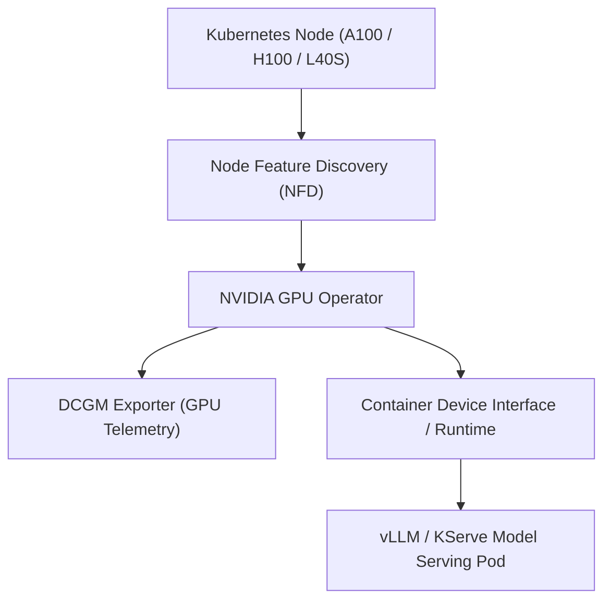

# Operationalizing Generative AI on Kubernetes

This skill guides the design, deployment, autoscaling, and lifecycle management of LLMs and generative AI workloads running on **Kubernetes**.

---

## 🏗️ 1. Cluster Infrastructure and GPU Acceleration

Serving LLMs requires specialized hardware allocation, driver management, and scheduling configurations:



### 1.1 Resource Allocations and Tolerations
```yaml
apiVersion: apps/v1
kind: Deployment
metadata:
  name: vllm-llama3-serving
spec:
  replicas: 2
  template:
    spec:
      tolerations:
        - key: "nvidia.com/gpu"
          operator: "Exists"
          effect: "NoSchedule"
      containers:
        - name: inference-engine
          image: vllm/vllm-openai:latest
          args:
            - "--model"
            - "/models/meta-llama-3-8b-instruct"
            - "--tensor-parallel-size"
            - "1"
            - "--gpu-memory-utilization"
            - "0.90"
            - "--max-model-len"
            - "8192"
          resources:
            limits:
              nvidia.com/gpu: "1"
              memory: 32Gi
              cpu: "8"
            requests:
              nvidia.com/gpu: "1"
              memory: 16Gi
              cpu: "4"
          volumeMounts:
            - mountPath: /models
              name: model-cache
      volumes:
        - name: model-cache
          persistentVolumeClaim:
            claimName: distributed-model-storage-pvc
```

---

## ⚡ 2. High-Throughput Serving Engines: vLLM and PagedAttention

Traditional transformer serving suffers from memory fragmentation due to dynamic sequence lengths. vLLM implements **PagedAttention**, modeling KV-cache memory identically to virtual memory operating system pages:
- **Zero KV-Cache Waste**: Reduces GPU memory waste from >60% to <4%.
- **Continuous Batching**: Dynamically inserts incoming requests into running iteration batches rather than waiting for entire batches to complete.

---

## 📈 3. Autoscaling Strategies: HPA & KEDA with Custom GPU Metrics

Standard CPU/Memory metrics are ineffective for LLM autoscaling. Scale based on GPU duty cycle, queue depth, or KV-cache usage:

```yaml
apiVersion: keda.sh/v1alpha1
kind: ScaledObject
metadata:
  name: llm-serving-scaler
spec:
  scaleTargetRef:
    name: vllm-llama3-serving
  minReplicaCount: 1
  maxReplicaCount: 8
  triggers:
    - type: prometheus
      metadata:
        serverAddress: http://prometheus-k8s.monitoring.svc:9090
        metricName: vllm_num_requests_waiting
        query: sum(vllm:num_requests_waiting{model="meta-llama-3-8b-instruct"})
        threshold: "5"
```

---

## 📦 4. Distributed Training and Inference with KubeRay

For distributed multi-node inference or fine-tuning (LoRA / DeepSpeed):
- Use **KubeRay Operator** to declare `RayCluster` resources.
- Employ **Fluid** or **JuiceFS** for distributed model weight caching across worker nodes to reduce container cold-start delays from gigabyte downloads.
