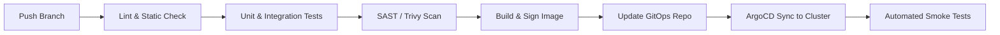

# Delivery Pipelines Examples

These are conditional operational examples, not universal provider choices. Version pins inherited from the source are not verified as current by this update; resolve the selected platform documentation before use. Authorization, secrets and release verification follow the parent skill and repository standards.

## 🔄 7. Modern CI/CD Pipelines

Software integrity is ensured by deterministic pipelines with code validation, continuous security (SAST/SCA/Container Scan), and automated deployment and rollback strategies.



### 🛠️ Production Pipeline (GitHub Actions)

```yaml
# .github/workflows/ci-cd-pipeline.yml
name: Continuous Integration & Deployment

on:
  push:
    branches: [main]
  pull_request:
    branches: [main]

permissions:
  contents: read
  packages: write
  id-token: write

env:
  REGISTRY: ghcr.io
  IMAGE_NAME: ${{ github.repository }}

jobs:
  validate:
    name: Lint, Test & SAST
    runs-on: ubuntu-latest
    steps:
      - name: Checkout Code
        uses: actions/checkout@v4

      - name: Setup Node.js Environment
        uses: actions/setup-node@v4
        with:
          node-version: 20
          cache: 'npm'

      - name: Install Dependencies & Run Tests
        run: |
          npm ci
          npm run lint
          npm test -- --coverage

      - name: Run Trivy Vulnerability Scanner (Filesystem)
        uses: aquasecurity/trivy-action@master
        with:
          scan-type: 'fs'
          ignore-unfixed: true
          severity: 'CRITICAL,HIGH'
          exit-code: '1'

  build-and-push:
    name: Build & Push OCI Image
    needs: [validate]
    if: github.ref == 'refs/heads/main'
    runs-on: ubuntu-latest
    outputs:
      image_tag: ${{ steps.meta.outputs.version }}
    steps:
      - name: Checkout Code
        uses: actions/checkout@v4

      - name: Set up Docker Buildx
        uses: docker/setup-buildx-action@v3

      - name: Log in to Container Registry
        uses: docker/login-action@v3
        with:
          registry: ${{ env.REGISTRY }}
          username: ${{ github.actor }}
          password: ${{ secrets.GITHUB_TOKEN }}

      - name: Extract Docker metadata
        id: meta
        uses: docker/metadata-action@v5
        with:
          images: ${{ env.REGISTRY }}/${{ env.IMAGE_NAME }}
          tags: |
            type=sha,format=short,prefix=
            type=raw,value=latest

      - name: Build and push Docker image
        uses: docker/build-push-action@v5
        with:
          context: .
          push: true
          tags: ${{ steps.meta.outputs.tags }}
          labels: ${{ steps.meta.outputs.labels }}
          cache-from: type=gha
          cache-to: type=gha,mode=max

  gitops-promote:
    name: Trigger GitOps Promotion
    needs: [build-and-push]
    runs-on: ubuntu-latest
    steps:
      - name: Update Target Image Tag in GitOps Repo
        uses: actions/github-script@v7
        with:
          github-token: ${{ secrets.GITOPS_REPO_PAT }}
          script: |
            // Trigger repository_dispatch or direct commit to GitOps repository
            console.log("Promoting image tag ${{ needs.build-and-push.outputs.image_tag }} to production");
```

### 🎯 Deployment and Rollback Strategies

| Strategy | Description | Pros | Cons | Rollback Mechanism |
| :--- | :--- | :--- | :--- | :--- |
| **Rolling Update** | Updates pods incrementally, batch by batch | Zero downtime, no extra infra cost | Mixed versions running simultaneously | `kubectl rollout undo deployment/<name>` |
| **Blue/Green** | Identical mirrored environment (Green) provisioned in parallel | Instant traffic switch, isolation | Double the infrastructure cost | Immediate traffic redirection in the Ingress/LoadBalancer |
| **Canary** | Sends a gradual percentage of traffic (e.g., 5% -> 25% -> 100%) | Early anomaly detection with telemetry | Requires a service mesh or advanced ingress controller | Automatic reversal upon detecting a rise in HTTP 5xx error rate |

---
