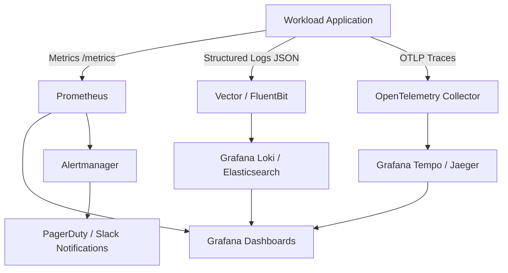

# Observability Examples

These are conditional operational examples, not universal provider choices. Version pins inherited from the source are not verified as current by this update; resolve the selected platform documentation before use. Authorization, secrets and release verification follow the parent skill and repository standards.

## 📊 8. Observability and Reliability Engineering (SRE)

Observability is not just passive monitoring; it is the ability to infer the system's internal state from its external outputs: **Metrics**, **Logs**, and **Traces**.



### 🚨 SLO/SLI-Based Alerts (Prometheus Operator)

```yaml
apiVersion: monitoring.coreos.com/v1
kind: PrometheusRule
metadata:
  name: order-service-slo-alerts
  namespace: production
  labels:
    role: alert-rules
spec:
  groups:
    - name: order-service-slo
      rules:
        # Calculate HTTP 5xx error rate over 5 minutes
        - record: job:http_requests_error_ratio:rate5m
          expr: |
            sum(rate(http_requests_total{job="order-service",status=~"5.."}[5m]))
            /
            sum(rate(http_requests_total{job="order-service"}[5m]))

        # Alert if burn rate exceeds 1% error budget rapidly
        - alert: HighHttpErrorRateSLOBurn
          expr: job:http_requests_error_ratio:rate5m > 0.01
          for: 2m
          labels:
            severity: critical
            team: payments
          annotations:
            summary: "Critical error budget burn rate on order-service"
            description: "High error rate detected: {{ $value | humanizePercentage }} of requests are failing with 5xx status."
            runbook_url: "https://wiki.company.com/ops/runbooks/order-service-5xx"
```

---
