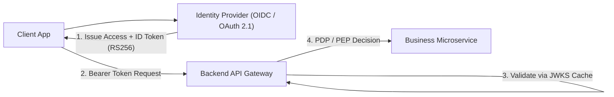

# Identity Security for Software Development

This skill codifies identity security engineering standards for software architects and developers building secure authentication, token validation, and access control architectures.

---

## 🔑 1. Modern Authentication and Token Architecture



### 1.1 Secure JWT Verification Standards
Never trust client headers or assume signatures are verified automatically:
1. **Algorithm Whitelisting**: Explicitly reject `alg: "none"` and symmetric algorithm confusion attacks (`HS256` passed when public key is expected). Enforce asymmetric signatures (`RS256`, `ES256`, `EdDSA`).
2. **Key Rotation & JWKS**: Fetch public keys dynamically from standard `/.well-known/jwks.json` endpoints. Cache keys locally with an explicit TTL and circuit breaker against DoS.
3. **Mandatory Claim Validation**:
   - `iss` (Issuer): Must match the exact IdP authority URL.
   - `aud` (Audience): Must match this API's registered resource identifier.
   - `exp` (Expiration): Enforce current timestamp $< exp$, with a conservative clock skew threshold ($\le 60\text{s}$).
   - `nbf` (Not Before): Enforce activation timestamp.

---

## 🛡️ 2. Fine-Grained Authorization Models

```
+-------------------------------------------------------------+
| RBAC (Role-Based)     | Group-level permissions (Admin, User) |
+-------------------------------------------------------------+
| ABAC (Attribute-Based)| User attributes + Resource state +    |
|                       | Environmental context (Time, IP)    |
+-------------------------------------------------------------+
| ReBAC (Relationship)  | Zanzibar graph: user has access via |
|                       | relation (owner, member, parent_org)|
+-------------------------------------------------------------+
```

### 2.1 Policy Enforcement Point (PEP) Pattern
Decouple business logic from authorization decisions:
- The service delegates authorization checks to a **Policy Decision Point (PDP)** (e.g., Open Policy Agent OPA / Cedar / OpenFGA).
- The service acts strictly as a **Policy Enforcement Point (PEP)**, blocking or permitting requests based on the boolean verdict.

---

## 🔒 3. Machine-to-Machine (M2M) Security

For inter-service microservice communications:
1. **OAuth 2.1 Client Credentials Grant**: Acquire scoped, short-lived tokens per service pair rather than static shared API keys.
2. **Mutual TLS (mTLS)**: Enforce cryptographic identity verification at layer 4/7 via SPIFFE/SPIRE certificates or service mesh sidecars (Envoy).
3. **Token Exchange (RFC 8693)**: Downscope user context tokens when calling downstream services to prevent privilege escalation.
