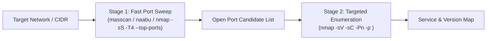
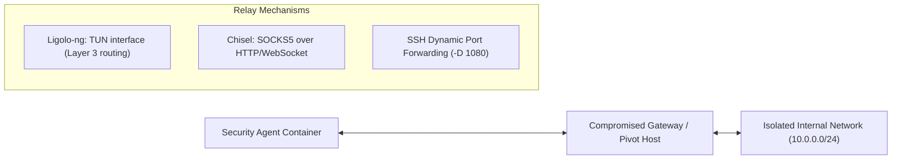

# Network Infrastructure Penetration Testing & Pivoting

This skill specifies methodology and operational procedures for **Layer 2/3/4 Network Penetration Testing**, pivoting across multi-homed hosts, and automating exploitation frameworks in non-interactive environments.

---

## 🎯 1. Two-Stage Network Reconnaissance

Avoid aggressive full-range SYN scanning with script probes on unverified networks. Use a two-stage approach:



### Stage 1: Port Discovery
- Sweep target CIDRs or hosts to locate active endpoints.
- Constrain packet rates to avoid saturating firewalls or triggering denial-of-service conditions.

### Stage 2: Service Fingerprinting
- Execute targeted version and default script checks strictly on ports confirmed open during Stage 1.
- Document banner versions, TLS cipher suites, and authentication mechanisms without firing active exploits.

---

## 🔍 2. Protocol-Specific Enumeration

Follow structured enumeration checklists per exposed service:

- **SMB (445/139)**: Enumerate shares (`netexec smb --shares`), null sessions, and signing requirements. Never execute anonymous write tests on non-test shares.
- **SNMP (161/udp)**: Probe default community strings (`public`, `private`) to harvest routing tables, network interfaces, and running process trees.
- **NFS (2049)**: List exports (`showmount -e`) and verify `no_root_squash` flags.
- **SSH / RDP / WinRM**: Inspect host keys, supported authentication methods, and NLA status.

---

## 🔀 3. Multi-Hop Pivoting and Tunneling Relays

When exploiting dual-homed compromised hosts to access internal segments:



### Pivoting Standards
1. **Ligolo-ng (Preferred for L3)**: Creates a virtual TUN adapter on the attacking machine, allowing native routing tools (`nmap`, `curl`, browser) to reach internal CIDRs transparently without proxy wrapper latency.
2. **Chisel (HTTP/WebSocket SOCKS5)**: Ideal for egress-filtered environments where outbound traffic is restricted to ports 80/443. Route tools via `proxychains4`.
3. **SSH Port Forwarding**:
   - Dynamic: `ssh -D 1080 user@pivot` (SOCKS5 proxy).
   - Local: `ssh -L 8443:internal-db:5432 user@pivot` (forward local port to internal service).
   - Remote: `ssh -R 8080:localhost:80 user@pivot` (reverse listener for incoming callbacks).

---

## ⚡ 4. Non-Interactive CLI Automation & Metasploit Guidance

Autonomous agents run commands in ephemerally bounded processes without interactive TTYs:

1. **Deterministic Single-Command Execution**:
   - Execute framework tasks in a single invocation that terminates automatically:
     ```bash
     msfconsole -q -x "use exploit/...; set RHOSTS <target>; set LPORT <port>; run; exit"
     ```
2. **Port Pre-Flight Checks**:
   - Before binding a listener port (`LPORT`), verify that the port is not already bound by a previous background process:
     ```bash
     ss -tuln | grep ":<port>"
     ```
3. **Background Services & Detachment**:
   - Long-running listeners must be registered as managed background tasks or run with explicit timeout guards.
4. **Credential Spraying Limits**:
   - Enforce password spraying lockout thresholds: pause attempts if account lockout counters are unknown, and restrict attempts to $\le 2$ passwords per spraying cycle.
