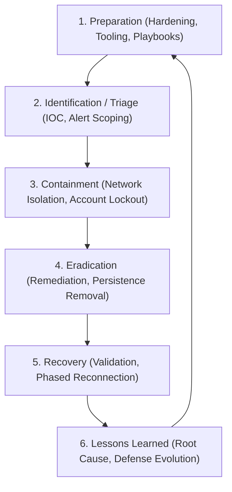

# Defensive Cybersecurity and Incident Response (Blue Team)

This skill formalizes operational frameworks and triage procedures for incident responders, SOC analysts, and blue team engineers handling active cyber incidents.

---

## 🛡️ 1. Incident Handling Lifecycle (PICERL)

### 1.1 Triage Scoping Matrix
- **Severity 1 (Critical)**: Active ransomware spread, root compromise of core domain controller/IAM, widespread business disruption. Immediate executive escalation.
- **Severity 2 (High)**: Compromise of sensitive production workloads or privileged user accounts without confirmed lateral movement.
- **Severity 3 (Medium)**: Isolated malware detection contained by EDR; suspected phishing credential harvest with MFA intact.
- **Severity 4 (Low)**: Policy violation, port scan activity, routine automated vulnerability probes.

---

## 🔎 2. Evidence Collection Order of Volatility (RFC 3227)

Responders must collect forensic artifacts in order of decreasing volatility to prevent evidence degradation:

1. **Registers, Peripheral Memory, and Cache**
2. **Main System Memory (RAM)**: Dump physical RAM using LiME (Linux) or WinPmem / DumpIt (Windows).
3. **Network State and Ephemeral Connections**: Routing tables, ARP cache, open sockets (`ss -tulpn`, `netstat -ano`).
4. **Running Process State and Process Memory**: Active task lists, unlinked executable binaries, injected DLLs/SOs.
5. **Disk and File System Metadata**: MFT, journal logs, persistent storage partitions.
6. **Remote Logging Data and Archival Backups**: SIEM records, cloud audit trails (CloudTrail, GuardDuty, Activity Logs).

---

## 🛑 3. Containment Strategies

- **Short-Term Containment**:
  - Sever egress connectivity on affected VLAN / Security Group.
  - Revoke active Kerberos ticket-granting tickets (TGT) and OAuth refresh tokens.
  - Isolate endpoints via EDR network containment while keeping sensor channel open.
- **Long-Term Containment**:
  - Deploy temporary firewall rules blocking C2 IP subnets and malicious domains.
  - Patch initial access vectors (e.g., exposed edge VPN vulnerability).
  - Snapshot running instances for offline forensic analysis.

---

## 🧹 4. Eradication and Recovery Verification

1. **Identify All Persistence Mechanisms**: Inspect Scheduled Tasks, Cron jobs, systemd services, WMI Event Subscriptions, registry Run keys, and authorized_keys files.
2. **Rebuild vs Cleanse**: In cloud/virtualized environments, **always rebuild from trusted golden images** rather than attempting to selectively delete adversary artifacts.
3. **Phased Reintroduction**: Restore systems into a quarantine monitoring segment with heightened telemetry logging before restoring full production traffic.
