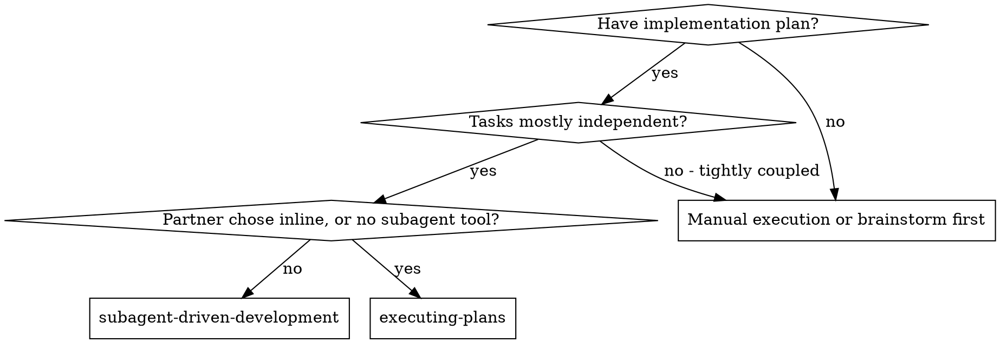
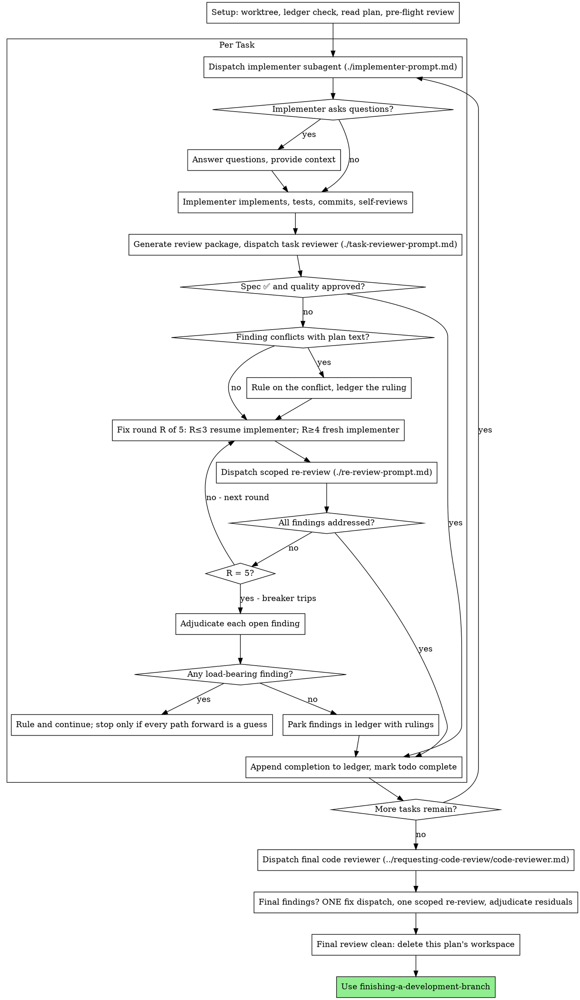

<!--
Coacus adaptation of a Superpowers workflow (MIT).
Upstream: https://github.com/obra/superpowers @ 5bf4e78011075bcfc0dc295f0724994cd123ee71
Process artifacts are written under docs/temp/.
Conventions: ../using-coacus/references/coacus-process-conventions.md
-->

# Subagent-Driven Development

Execute plan by dispatching a fresh implementer subagent per task, a task review (spec compliance + code quality) after each, and a broad whole-branch review at the end.

**Why subagents:** You delegate tasks to specialized agents with isolated context. By precisely crafting their instructions and context, you ensure they stay focused and succeed at their task. They should never inherit your session's context or history — you construct exactly what they need. This also preserves your own context for coordination work.

**Core principle:** Fresh subagent per task + task review (spec + quality) + broad final review = high quality, fast iteration

**Narration:** between tool calls, narrate at most one short line — the
ledger and the tool results carry the record.

**Continuous execution:** Do not pause to check in with your human partner between tasks. Execute all tasks from the plan without stopping. The only reasons to stop are the four named below, or all tasks complete. "Should I continue?" prompts and progress summaries waste their time — they asked you to execute the plan, so execute it.

**Rulings, not stalls.** A running plan does not wait on a human. Conflicts,
ambiguities, plan defects, a cap you would have asked to exceed — decide
them. The spec is the binding authority, the plan is its argument, and your
judgment settles what neither answers. Record every decision in the ledger as
`Ruling: <what you decided> — <why> — <what it costs if wrong>`, and keep
going. A wrong ruling costs rework your human partner can see and undo; a
session parked on a question costs their whole day and buys nothing.

Four things stop you, and only these: an irreversible or destructive
operation; a security-sensitive action; a side effect outside this worktree
that norms say you ask about first (a merge, a push to a shared branch, a
publish); and a plan so broken that every path forward is a guess. For those,
stop and ask.

## When to Use

**vs. Executing Plans (inline):**
- Fresh subagent per task (no context pollution) instead of one context doing every task
- Review after each task (spec compliance + code quality) instead of only at the end
- Costs a fresh context per task and per review; inline costs one context plus one final reviewer
- Both run in this session, share the same plan workspace and ledger, and never pause between tasks

## The Process

## Setup

Ensure the work happens in an isolated workspace: use
using-git-worktrees to create one or verify the existing one.
Never start implementation on a main/master branch without your human
partner's explicit consent.

Conversation memory does not survive compaction. In real sessions,
controllers that lost their place have re-dispatched entire completed task
sequences — the single most expensive failure observed. Track progress in
a ledger file, not only in todos.

- Each plan owns a workspace: at skill start, run this skill's
  `python3 scripts/sdd-workspace.py PLAN_FILE` — it prints the plan's git-ignored
  directory (under `<repo-root>/.coacus/sdd/`), home to
  every artifact for THIS plan: ledger, briefs, reports, review packages.
  Another plan's directory is never yours to read or write.
- Check for this plan's ledger at `<workspace>/progress.md`. If its first
  line names your plan file, tasks with a `Task <N>: complete` line are DONE
  — do not re-dispatch them; resume at the first task without one. A task
  whose last line is a fix round is mid-loop: resume the loop at the next
  round. A ledger whose first line names a different plan file — or a stray
  ledger at the old flat path `.coacus/sdd/progress.md` — is another
  plan's progress: leave it in place and start your own, fresh.
- Create the ledger with its identity as the first line:
  `# SDD ledger — plan: <plan file path>`.
- The ledger is your recovery map: the commits it names exist in git even
  when your context no longer remembers creating them. After compaction,
  trust the ledger and `git log` over your own recollection.
- `git clean -fdx` will destroy the workspace (it's git-ignored scratch); if
  that happens, recover from `git log`.

Read the plan once, note its context and Global Constraints, and create a
todo per task. If the plan names a Spec, read that too: the spec is the
authority the plan argues from, and conflicts inside the plan resolve
against it. A plan with no reachable spec gets a ledger note saying so —
rulings made without one are provisional.

Before dispatching Task 1, scan the plan once for conflicts, writing down
what you checked as you check it:

- tasks that contradict each other or the plan's Global Constraints
- anything the plan explicitly mandates that the review rubric treats as a
  defect (a test that asserts nothing, verbatim duplication of a logic block)

The scan's output is a table, not a verdict. One row for every pair of tasks
that share a file or an interface: the two tasks, what one produces against
what the other consumes, and what you found. One row for every task: whether
its own text agrees with itself — the tests it specifies against the code it
specifies, the files it creates against the files it later touches. "The scan
is clean" without those rows is not a scan you ran.

Write the table to the ledger. Rule on everything you find before execution
begins — each finding against the plan text that mandates it — and record
each ruling in the ledger. If the scan is clean, proceed without comment.
Rule on each conflict it surfaces — the spec is the binding authority, the
plan is its argument — record the ruling beside its row, and dispatch
Task 1. The review loop remains the net for conflicts that only emerge from
implementation.

## Model Selection

Inherit the session model by default. Specify a model only if the user explicitly requests one and the harness permits it. A blocked task calls for better context, narrower scope, a fresh implementer or human escalation; never override model selection policy to retry it.

## The Task Loop

Batch small, repetitive same-shape edits into one dispatch brief. For judgment, tests, or isolated review surfaces, use one dispatch per task. Hand artifacts over as file paths rather than pasting them into prompts to preserve context.

For detailed contracts, see [Task Loop Mechanics](references/task-loop-mechanics.md).

### 1. Dispatch the implementer

Record BASE (`git rev-parse HEAD`). Run `python3 scripts/task-brief.py PLAN_FILE N` to generate the task brief. If the plan session produced an agent roster (`writing-plans` → Agent Roster), dispatch the roster agent assigned to this task; otherwise use the generic implementer. Dispatch the implementer subagent with: (1) project placement, (2) brief path as binding authority, (3) necessary interface decisions, and (4) the dedicated report path (`…/task-N-report.md`). Never make subagents read the full plan file, and enforce the no-subagents rule.

Template: [implementer-prompt.md](implementer-prompt.md)

### 2. Handle the report

Implementers report one of four statuses:
- **DONE:** Generate review package (`python3 scripts/review-package.py PLAN_FILE BASE HEAD`) and dispatch the task reviewer.
- **DONE_WITH_CONCERNS:** Inspect concerns. Address correctness issues immediately; note observations and proceed to review.
- **NEEDS_CONTEXT:** Supply missing context and re-dispatch.
- **BLOCKED:** Assess the blocker. Provide context, break down the task, or ledger plan corrections. Never force retry without changes.

### 3. Review the task

Every task requires two verdicts: spec compliance AND task quality. Self-review never replaces task review.
- Run `python3 scripts/review-package.py PLAN_FILE BASE HEAD` and hand the reviewer the resulting diff package, brief path, report path, and project Global Constraints.
- Never dispatch without a diff package or pre-judge findings.
- Resolve any "⚠️ Cannot verify from diff" items; if verified as real gaps, route them to the fix loop.

Template: [task-reviewer-prompt.md](task-reviewer-prompt.md)

### 4. The fix loop

Triggered when the review reports spec ❌, Critical/Important findings, or verified gaps. Up to 5 rounds maximum per task:
- **Deferred minors:** Record Minor findings in the ledger (`Task <N>: minor (deferred): <one-liner>`) for final whole-branch triage; they do not enter the loop.
- **Plan conflicts:** Adjudicate against the spec, ledger the ruling, and direct the fix.
- **Rounds 1–3:** Resume the existing implementer with the open findings list.
- **Rounds 4–5:** Dispatch a fresh implementer  with full failure history.
- **Re-review:** Scoped re-review via `python3 scripts/review-package.py PLAN_FILE FIX_BASE HEAD` with [re-review-prompt.md](re-review-prompt.md).
- **The Breaker:** At round 5 cap, stop dispatching. Adjudicate each open finding (park with ruling, or rule on load-bearing items).

### 5. Complete the task

When review is clean or all open findings are adjudicated at the breaker cap, record completion in the ledger:
- `Task <N>: complete (commits <base7>..<head7>, review clean)`
- `Task <N>: complete (commits <base7>..<head7>, <K> parked)`

Mark the todo complete and proceed to the next task.

Then mark the todo complete and move on. Never move to the next task while
the review has open Critical/Important issues that are neither fixed nor
parked-with-ruling at the cap.

## Final Review

The final whole-branch review gets a package too: run
`python3 scripts/review-package.py PLAN_FILE MERGE_BASE HEAD` (MERGE_BASE = the commit the
branch started from, e.g. `git merge-base main HEAD`) and include the
printed path in the final review dispatch, so the final reviewer reads
one file instead of re-deriving the branch diff with git commands. Dispatch
using
requesting-code-review's
[code-reviewer.md](../requesting-code-review/code-reviewer.md). Point it at
the ledger's deferred-minor and parked lines so it can triage which must be
fixed before merge.

If the final whole-branch review returns findings, dispatch ONE fix subagent
with the complete findings list — not one fixer per finding.
Per-finding fixers each rebuild context and re-run suites; a real
session's final-review fix wave cost more than all its tasks combined.
Then run exactly one scoped re-review of the fix wave
(`python3 scripts/review-package.py PLAN_FILE FIX_BASE HEAD` over the fix range,
[re-review-prompt.md](re-review-prompt.md)).
Adjudicate any residual findings as in the task loop's breaker: park with
rulings, or rule on the load-bearing ones and ledger what you decided. Only
the four classes above stop you here. There is no second fix wave —
residual load-bearing findings surface to your human partner when
finishing-a-development-branch presents the options.

## Finish

Before you delete anything, collect every ledger line containing `Ruling:` —
preflight rulings, parked findings, breaker adjudications, all of them — into
your final message under "Rulings I made", in the order you made them, each
with what it costs if wrong. The list is exhaustive: if the ledger holds a
ruling, the list holds it. That list is the only place the decisions you
took on your human partner's behalf reach them — they read it and rework
whatever you got wrong. A ruling that dies with the workspace was a decision
made in secret.

When the final whole-branch review is clean and its fixes are merged,
delete this plan's workspace (`rm -rf <workspace>`) — the git history is
the record now. Sibling directories belong to other plans; leave them
alone.

Use finishing-a-development-branch.

## Operational Mechanics & Examples

Detailed execution workflows and deep operational references:
- [Workflow Examples & Rationalizations](references/workflow-examples.md) — Concrete walkthroughs, common rationalizations, and mental patterns.
- [Task Loop Mechanics](references/task-loop-mechanics.md) — Subagent dispatching details, status triages, diff packaging edge cases, and breaker protocols.

